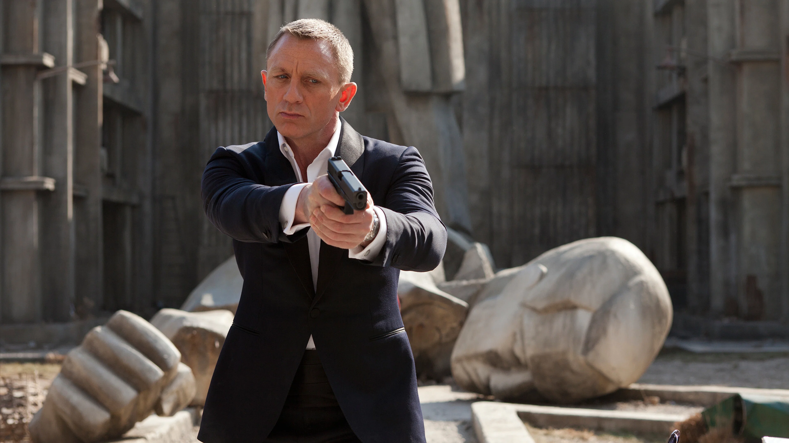

 

# 007 &nbsp;//&nbsp; DANIEL CRAIG ERA

A DIGITAL EXHIBITION &nbsp;·&nbsp; 2006 — 2021

 

  <a href="https://kaaasaa.github.io/007-craig-era/"><strong>ENTER EXHIBITION &nbsp;↗</strong></a>

 

 

*Fifteen years. Five chapters.*  
*Stripped of mid-century flippancy, an interactive darkroom archive dedicated to the flesh, shadow, and quiet dignity of Daniel Craig's James Bond.*

 

十五载风霜，五部银幕篇章。 
一座献给丹尼尔·克雷格版 007 的哑光暗房数字展厅——剥离浮华与冗余，只留光影、机械呼吸与克制的质感。

 

---

### Viewing Notes &nbsp;/&nbsp; 观展须知

- **Desktop Display** — Composed specifically for wide desktop screens and cursor choreography.  
  本作品为桌面端大屏视听献礼，建议在桌面浏览器开启完整体验。
- **Sound On** — Enable audio before entering; stillness is also part of the score.  
  建议开启声音入场；当声响退去，静默本身亦是配乐的一部分。
- **Unscripted** — There are no manuals or visual prompts inside the exhibition. Linger over the stillness, and let your cursor wander.  
  展厅内隐去了全部操作指引。不必匆忙，放慢节奏，任指针在暗处停留。

 

---

### Exhibition Sequence &nbsp;/&nbsp; 展陈脉络

| Act | Chapter | Period |
| :--- | :--- | ---: |
| `01` | **The Five Chapters** — *Casino Royale · Quantum of Solace · Skyfall · Spectre · No Time to Die* | 2006 — 2021 |
| `02` | **Aesthetic Artifacts** — *特工器物志* | Darkroom Study |
| `03` | **Curtain Call** — *终章* | Epilogue |

 

---

### Medium & Craft &nbsp;/&nbsp; 工艺注脚

- **Architecture** — Zero-framework vanilla HTML, CSS, and JavaScript, choreographed with GSAP.
- **Acoustics** — Real mechanical Foley embedded offline via Web Audio API, paired with scroll-synced archival scores.
- **Motion** — Pure native SVG Bézier path choreography without external morphing plugins.
- **Portability** — Fully self-contained static archive; opens directly via `index.html` or static web hosting.

 

---

  <strong>Non-Commercial Tribute Notice</strong> 
  James Bond, 007, and all related film imagery and musical excerpts are the property of EON Productions, MGM, and Danjaq, LLC. 
  This project is an independent, non-commercial digital design study and artistic homage.

  

CURATED & CRAFTED BY 
**HN STUDIO**

 

